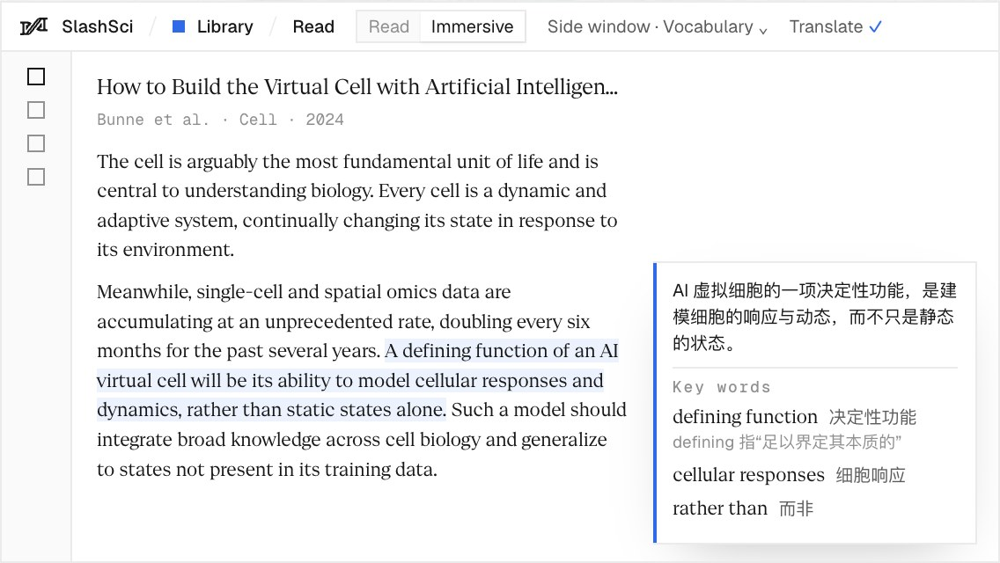
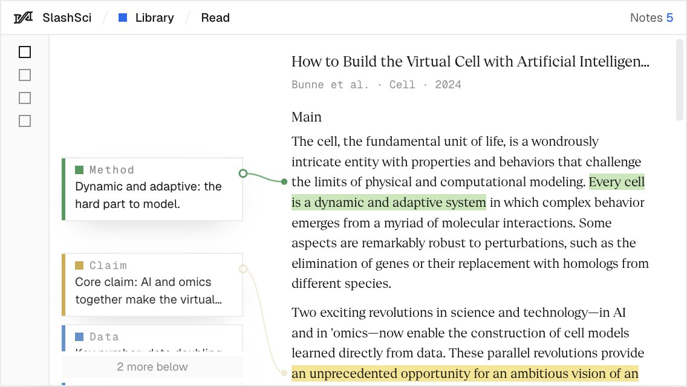
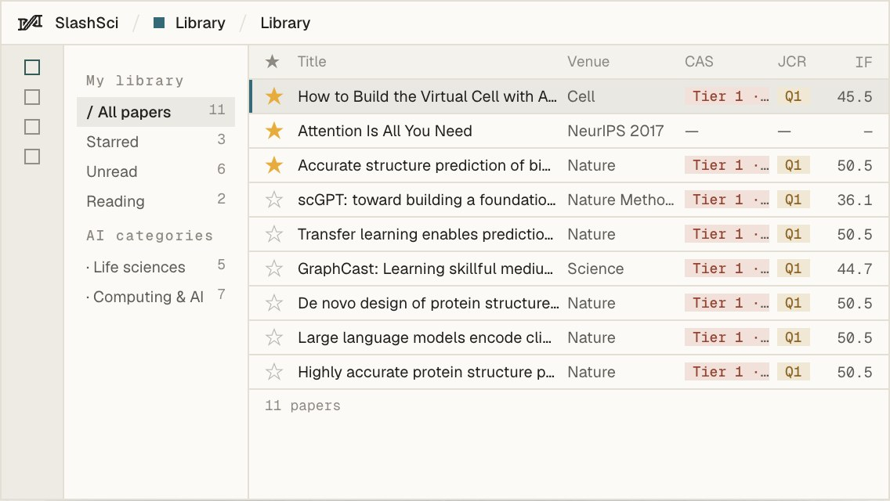
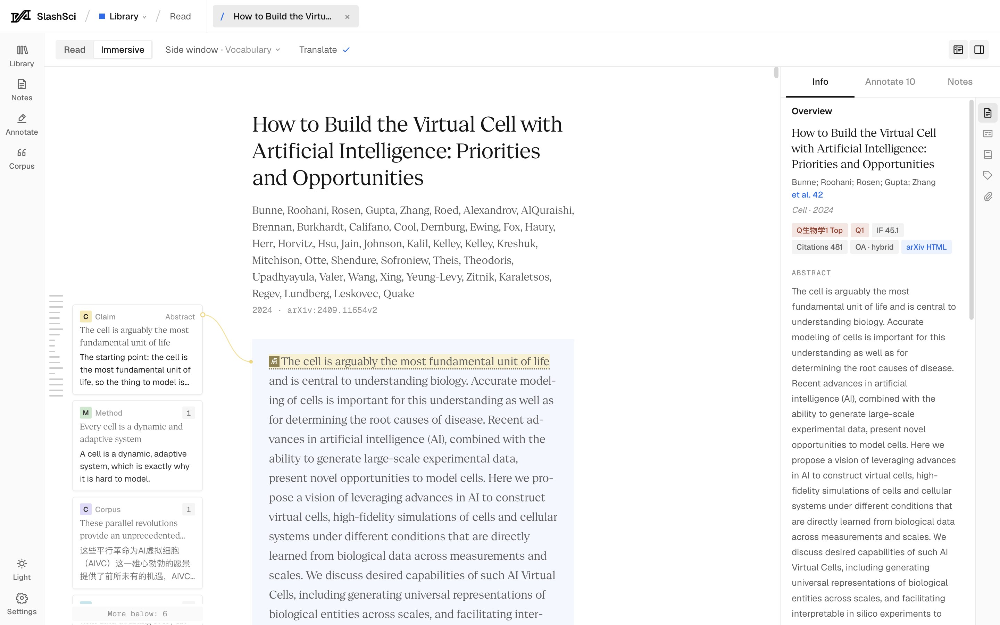

<p align="right"><sub><a href="README.md">简体中文</a> · <a href="README.zh-Hant.md">繁體中文</a> · <b>English</b></sub></p>

<a href="https://slashsci.com/en/"><picture>
  <source media="(prefers-color-scheme: dark)" srcset="docs/img/readme/en/hero-dark.jpg">
  
</picture></a>

<h1 align="center">SlashSci Library</h1>

<p align="center"><b>Literature management, rebuilt for the AI era</b><br>
Block-level · Immersive · Local-first · Agent-ready</p>

<p align="center">
<a href="../../releases/latest"></a>


<a href="https://discord.com/invite/ewNMAHvWsp"></a>
</p>

<p align="center">
<a href="https://xybioinfo.feishu.cn/share/base/shrcnYgv3JESRb7W4mUVEw9qzxZ"><b>Apply for the beta</b></a> ·
<a href="https://slashsci.com/en/"><b>Website</b></a> ·
<a href="https://slashsci.com/en/#demo"><b>Try it online</b></a> ·
<a href="#download-and-install"><b>Download</b></a> ·
<a href="#beta-community"><b>Beta community</b></a> ·
<a href="../../issues"><b>Feedback</b></a>
</p>

> [!NOTE]
> **Alpha beta · applications open**: SlashSci Library is in a small alpha beta. The macOS (Apple silicon) and Windows (64-bit) installers can be downloaded freely. [Fill in a short questionnaire →](https://xybioinfo.feishu.cn/share/base/shrcnYgv3JESRb7W4mUVEw9qzxZ) (about 3 minutes) to request a beta code; once approved, it's sent to your email, and you link it in the app to get started.

## What it does

From understanding a paper to building a library of your own knowledge.

<table>
<tr>
<td width="56%"></td>
<td width="44%">
<sub>01 / Structured reading</sub>
<h3>Understand</h3>
<p>The paper itself, not the layout of a PDF.</p>
<ul>
<li><b>Block-level full text</b>: sections, equations, figures and references kept in structure; equations rendered with KaTeX; citations open in place and import in one click</li>
<li><b>Sentence-by-sentence translation</b>: the translation and in-context glosses appear beside the sentence under the pointer; switch between original, translation and parallel views</li>
<li><b>Publication-grade figures</b>: contents, citations and figures expand in place; replace any figure with the publisher's high-resolution original</li>
</ul>
</td>
</tr>
<tr>
<td width="44%">
<sub>02 / Anchored annotation</sub>
<h3>Capture</h3>
<p>Every thought, anchored to the source.</p>
<ul>
<li><b>Floating anchored notes</b>: notes line the margin in real time, joined to their passages by curves; four colours for claim, method, data and question</li>
<li><b>Two-way tracing</b>: click a note to land on its passage; notes take Markdown and LaTeX and jump back to what they quote</li>
<li><b>Corpus and term bank</b>: keep strong sentences and key terms, each with translation, source and a note on the writing</li>
</ul>
</td>
<td width="56%"></td>
</tr>
<tr>
<td width="56%"></td>
<td width="44%">
<sub>03 / A local library</sub>
<h3>Command</h3>
<p>Your data stays local; your search stays instant.</p>
<ul>
<li><b>Import from anywhere</b>: DOI, arXiv ID, PMCID or URL in one step; a PDF first looks online for structured full text; the browser extension saves pages behind a login</li>
<li><b>Journal metrics and AI sorting</b>: CAS and JCR quartiles, impact factors and citation counts at a glance; AI sorts papers by field; full-text search and de-duplication in Chinese and English</li>
<li><b>Local-first, built for agents</b>: the whole library in open formats on your machine, exported in one click; a built-in MCP server lets Claude Code and other agents search it directly</li>
</ul>
</td>
</tr>
</table>

## The real thing

This is Library's reading view: immersive mode, margin notes and paper details. The demo window on the website runs this same app; try it without installing anything.

<a href="https://slashsci.com/en/#demo"></a>

<p align="center"><a href="https://slashsci.com/en/#demo"><b>Try it in the browser →</b></a></p>

## Data and privacy

**Your papers live on your computer, and only there.**

- **Stored locally**: Papers are kept in open formats (JSON, Markdown, XML) in a folder on your machine: nothing is uploaded, and no platform locks you in. SQLite is only a rebuildable index.
- **Your keys stay yours**: Translation and AI keys are saved only on your computer, and which service to use is up to you; with Ollama it works fully offline.
- **Take it with you**: Export the whole library in one click; moving computers or archiving never depends on us. The original text is immutable; your notes, translations and edits are stored separately.

Everything in your library is an open format:

```text
paper.json              the immutable block tree
annotations.json        notes
translations/zh.json    translation, aligned by sentence
notes.md                reading notes
source/                 the original PDF / XML
index.sqlite            rebuildable
```

## Download and install

| Platform | Requirements | Status |
| --- | --- | --- |
| **macOS** | Apple silicon · macOS 13 or later | In beta · [latest build](../../releases/latest) |
| **Windows** | 64-bit · Windows 10 or later | In beta · [latest build](../../releases/latest) |

The installers can be downloaded from [Releases](../../releases/latest). [Fill in a short questionnaire](https://xybioinfo.feishu.cn/share/base/shrcnYgv3JESRb7W4mUVEw9qzxZ) (about 3 minutes) to request a beta code; once approved, it's sent to your email, and you link it in the app to get started.

**Installing the beta**

1. **macOS**: download `SlashSci-<version>-arm64.dmg`, open it and drag SlashSci into Applications.
2. **Windows**: download `SlashSci-<version>-x64.exe` and double-click it to install.
3. If the system blocks the first launch, see below.
4. The first time you open the app, enter the email the code was sent to and the code, and click “Link”.
5. When a new version is out, an “Update” button appears on the left of the app; click it to download.

<details>
<summary>Blocked on first launch?</summary>

The beta is not signed yet, and this is the system's standard message for unsigned apps. You only need to do this once.

- **macOS** (“can't verify the developer”): go to System Settings → Privacy & Security and click “Open Anyway” near the bottom.
- **macOS** (“is damaged and can't be opened” / “You should eject the disk image”): this is the quarantine flag macOS adds to downloads; the app is not actually damaged. Drag SlashSci into Applications first, then run this in Terminal and open it again:

  ```
  xattr -cr /Applications/SlashSci.app
  ```
- **Windows** (blue “Windows protected your PC” screen): click “More info”, then “Run anyway”.

</details>

> [!TIP]
> Your library lives in the `SlashSci-Library` folder on your computer. Back it up now and then with Settings → Library → Export the whole library.

## Beta community

**Join the beta and help shape Library**. Get new builds first and talk to the developer directly about problems and ideas.

<table>
<tr>
<td align="center" width="33%">
<br>
<b>Discord</b><br>
<sub>Scan or follow the link to join the Discord community</sub><br>
<a href="https://discord.com/invite/ewNMAHvWsp">Join Discord →</a>
</td>
<td align="center" width="33%">
<br>
<b>WeChat</b><br>
<sub>Scan with WeChat to join the beta group</sub><br>
&nbsp;
</td>
<td align="center" width="33%">
<br>
<b>Xiaohongshu</b><br>
<sub>Scan or follow the link to the Xiaohongshu group</sub><br>
<a href="http://xhslink.com/m/MAL0EEu5FS">Join the Xiaohongshu group →</a>
</td>
</tr>
</table>

## The SlashSci series

| Product | Status | What it is |
| --- | --- | --- |
| **Library** | In beta | Literature management and immersive reading: import, read, translate, annotate, collect, search. |
| **Studio** | In development | Research ideation and visual workflow orchestration: from papers to hypotheses, from hypotheses to experiment design. |
| **Bot** | In development | A personal research assistant and task automation: watching the literature, running pipelines, drafting, all on your own library. |

## Feedback

Please report problems or ideas in [Issues](../../issues), with the version (Settings → About) and your system. You are also welcome to find us in the beta groups.

---

<p align="center"><sub><a href="https://slashsci.com/en/">slashsci.com</a> · © 2026 SlashSci. All rights reserved.</sub></p>
