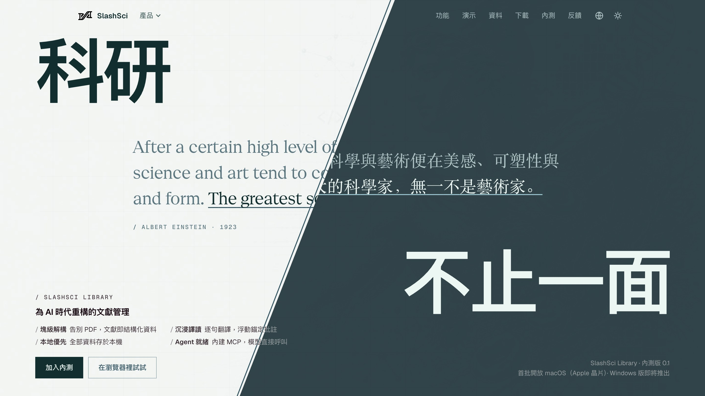
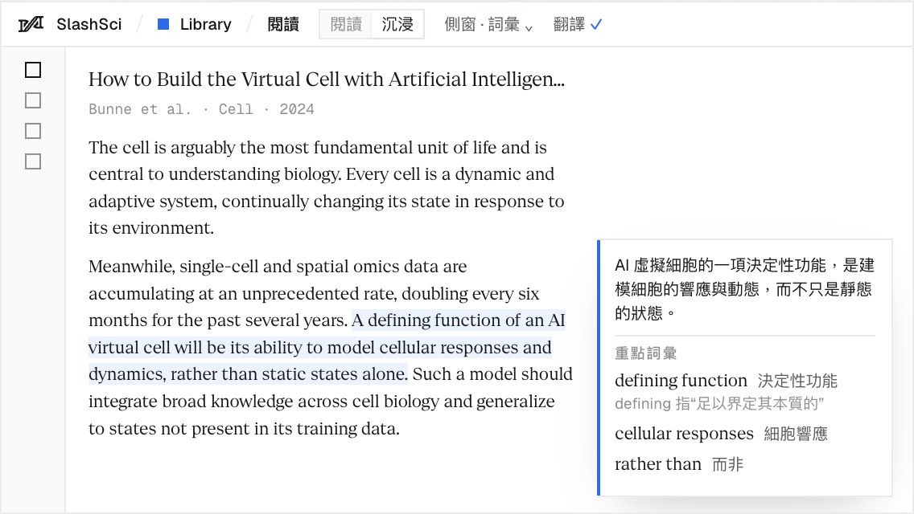
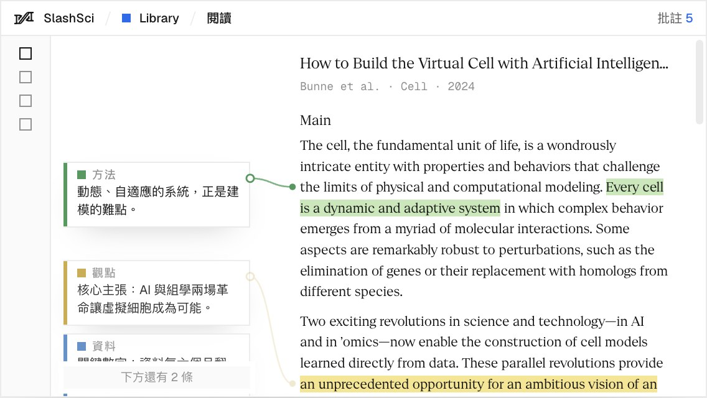
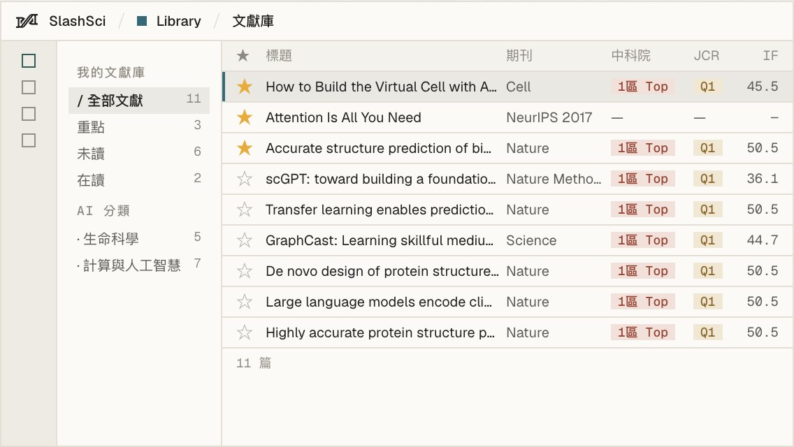
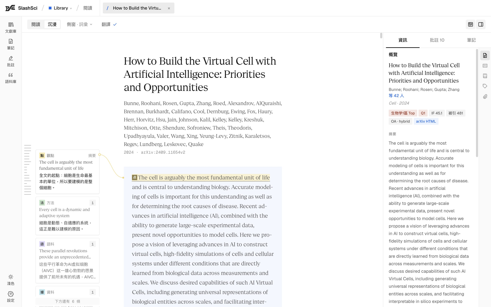

<p align="right"><sub><a href="README.md">简体中文</a> · <b>繁體中文</b> · <a href="README.en.md">English</a></sub></p>

<a href="https://slashsci.com/zh-hant/"><picture>
  <source media="(prefers-color-scheme: dark)" srcset="docs/img/readme/zh-hant/hero-dark.jpg">
  
</picture></a>

<h1 align="center">SlashSci Library</h1>

<p align="center"><b>為 AI 時代重構的文獻管理</b><br>
塊級解構 · 沉浸譯讀 · 本地優先 · Agent 就緒</p>

<p align="center">
<a href="../../releases/latest"></a>


<a href="https://discord.com/invite/ewNMAHvWsp"></a>
</p>

<p align="center">
<a href="https://slashsci.com/zh-hant/"><b>官網</b></a> ·
<a href="https://slashsci.com/zh-hant/#demo"><b>線上試用</b></a> ·
<a href="#下載與安裝"><b>下載</b></a> ·
<a href="#內測社群"><b>內測社群</b></a> ·
<a href="../../issues"><b>問題反饋</b></a>
</p>

> [!NOTE]
> **內測階段 · 首批開放 macOS**：SlashSci Library 目前處於小範圍內測，首批開放 macOS（Apple 晶片），Windows 版將在穩定後推出。加入內測社群，即可獲取安裝包、安裝指引與更新通知，並直接向開發者反饋。

## 核心能力

從讀懂一篇論文，到沉澱成自己的知識庫。

<table>
<tr>
<td width="56%"></td>
<td width="44%">
<sub>01 / 結構化精讀</sub>
<h3>讀懂</h3>
<p>回到論文本身，而非 PDF 的版面。</p>
<ul>
<li><b>塊級全文解析</b>：章節、公式、圖表與參考文獻按結構完整保留；公式以 KaTeX 渲染，引文就地展開並可一鍵收錄</li>
<li><b>沉浸式逐句譯讀</b>：譯文與語境詞彙釋義隨游標浮現於句側，原文、譯文、對照三種檢視即時切換</li>
<li><b>出版級影像</b>：目錄、引文與圖表就地展開，插圖可一鍵替換為出版商高畫質原圖</li>
</ul>
</td>
</tr>
<tr>
<td width="44%">
<sub>02 / 錨定式批註</sub>
<h3>沉澱</h3>
<p>每一處思考，都錨定在原文之上。</p>
<ul>
<li><b>浮動錨定批註</b>：批註沿頁邊即時排布，以曲線連回原文位置；觀點、方法、資料、疑問四色分類</li>
<li><b>雙向溯源</b>：點選批註即定位原文，筆記支援 Markdown 與 LaTeX，引用後一鍵回到出處</li>
<li><b>語料與術語庫</b>：收錄佳句與重點術語，自動附譯文、出處與寫法解讀</li>
</ul>
</td>
<td width="56%"></td>
</tr>
<tr>
<td width="56%"></td>
<td width="44%">
<sub>03 / 本地文獻庫</sub>
<h3>掌控</h3>
<p>資料留在本地，檢索盡在指尖。</p>
<ul>
<li><b>多源收錄</b>：DOI、arXiv、PMCID 或網址一步匯入；PDF 優先聯網匹配結構化全文；瀏覽器外掛支援需登入的頁面</li>
<li><b>期刊指標與智慧分類</b>：中科院分割槽、JCR、影響因子與被引次數一覽；AI 按學科自動歸類，中英文全文檢索與查重</li>
<li><b>本地優先，為 Agent 而生</b>：全庫以開放格式存於本機，一鍵匯出遷移；內建 MCP 服務，Claude Code 等 Agent 可直接檢索</li>
</ul>
</td>
</tr>
</table>

## 真實介面

下圖是 Library 的閱讀頁：沉浸模式、頁邊批註與文獻資訊。官網的演示窗裡執行的就是這個應用，無需安裝即可試用。

<a href="https://slashsci.com/zh-hant/#demo"></a>

<p align="center"><a href="https://slashsci.com/zh-hant/#demo"><b>在瀏覽器裡試試 →</b></a></p>

## 資料與隱私

**你的文獻，只在你的電腦上。**

- **本機儲存**：文獻以 JSON、Markdown 和 XML 等開放格式儲存在本機資料夾，不上傳伺服器，也不被任何平臺鎖定。SQLite 只做可重建的索引。
- **金鑰自己保管**：翻譯與 AI 服務的金鑰只儲存在你的電腦裡，用哪一家由你決定；接 Ollama 可以完全離線。
- **隨時帶走**：整庫一鍵匯出，換電腦、做存檔，都不依賴我們。原文不可變，你的批註、譯文和修改分開存放。

文獻庫裡的檔案都是開放格式：

```text
paper.json              原文塊樹
annotations.json        批註
translations/zh.json    譯文，按句對齊
notes.md                筆記
source/                 原始 PDF / XML
index.sqlite            可重建
```

## 下載與安裝

| 平臺 | 系統要求 | 狀態 |
| --- | --- | --- |
| **macOS** | Apple 晶片 · macOS 13 及以上 | 內測中 · [下載最新版](../../releases/latest) |
| **Windows** | 64 位 · Windows 10 及以上 | 即將推出 |

安裝包通過內測社群發放；已加入的成員也可以直接在 [Releases](../../releases/latest) 下載最新版本。

**安裝說明（macOS 內測版）**

1. 下載 `SlashSci-<版本>-arm64.dmg`，開啟後把 SlashSci 拖進「應用程式」。
2. 第一次開啟時如果被系統攔截，見下方說明。
3. 新版本釋出後，應用左側會出現「新版本」按鈕，點一下即可下載。

<details>
<summary>第一次開啟時提示「無法驗證開發者」？</summary>

內測版尚未簽名，這是 macOS 對未簽名應用的預設提示。到「系統設定 → 隱私與安全性」，在頁面下方點「仍要開啟」即可，只需操作一次。

</details>

> [!TIP]
> 你的文獻儲存在本機的 `SlashSci-Library` 資料夾裡。建議隔一段時間在「設定 → 文獻庫 → 匯出整個文獻庫」備份一次。

## 內測社群

**加入內測，一起打磨 Library**。第一時間獲取新版本，直接向開發者反饋問題與建議。

<table>
<tr>
<td align="center" width="33%">
<br>
<b>Discord</b><br>
<sub>掃碼或通過連結加入 Discord 社群</sub><br>
<a href="https://discord.com/invite/ewNMAHvWsp">加入 Discord →</a>
</td>
<td align="center" width="33%">
<br>
<b>微信</b><br>
<sub>用微信掃碼加入內測群</sub><br>
&nbsp;
</td>
<td align="center" width="33%">
<br>
<b>小紅書</b><br>
<sub>掃碼或通過連結加入小紅書群</sub><br>
<a href="http://xhslink.com/m/MAL0EEu5FS">加入小紅書群 →</a>
</td>
</tr>
</table>

## 斜槓科研系列

| 產品 | 狀態 | 簡介 |
| --- | --- | --- |
| **Library** | 內測中 | 文獻管理與沉浸式閱讀：匯入、閱讀、翻譯、批註、語料、檢索。 |
| **Studio** | 開發中 | 科研構思與視覺化工作流編排：從文獻到假設，從假設到實驗設計。 |
| **Bot** | 開發中 | 個人科研助手與任務自動化：盯文獻、跑流程、寫草稿，都基於你自己的庫。 |

## 問題反饋

遇到問題或有建議，請在 [Issues](../../issues) 裡提出，並附上版本號（「設定 → 關於」）和系統資訊。也歡迎直接在內測群裡找我們。

---

<p align="center"><sub><a href="https://slashsci.com/zh-hant/">slashsci.com</a> · © 2026 SlashSci. All rights reserved.</sub></p>
